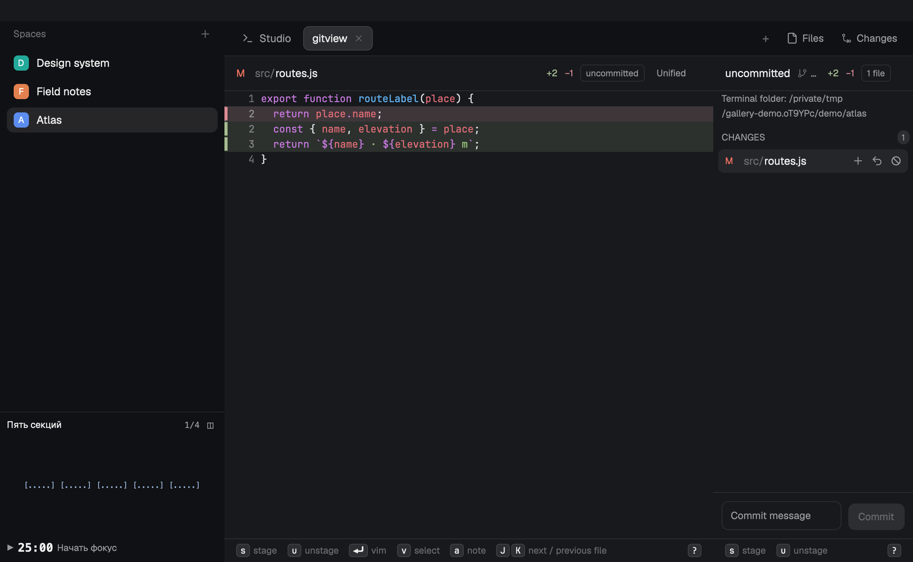

# Herdr Toolbox

One workspace for a short coding session: pick a space, start a focus interval, insert a saved snippet and review your changes without leaving the window. Spaces and Agents stays in the sidebar. The optional ASCII timer is shown in the preview below. Snippets opens over the terminal; Gitview opens in a review tab.

## What you see

From left to right: a 268 px sidebar and the active workspace. The sidebar gives its available height to Spaces and Agents, reserving 180 px for Taktik only while it is visible. The workspace has a 42 px tab strip and a pane below. Use the active Herdr theme. Use Herdr’s current interface font throughout the timer and center each ASCII character in an equal-width cell. In the review tab, display a diff beside the changed-file list; keep the sidebar visible.

## How it behaves

- Click a space to switch; right-click a space or agent and choose Rename to name that space or agent pane. Without a pane name, show the program, not its session title. The name belongs to the pane, not to the process or tab. Show agents with their space, using the theme's working, blocked, done or idle color. The navigation keys move to the previous or next agent in display order.
- The timer starts hidden. Search for `taktik` in the command palette and choose **Тактик: показать / скрыть** to show or hide it without changing its clock. Click the timer to start or pause. A cycle has four 25-minute focus intervals; short breaks last five minutes, the fourth break lasts fifteen. A break starts automatically, but the next focus waits for a click. `+5` extends focus without moving the original target. `↺` resets only this interval. Clicking the round counter resets the cycle to idle focus 1/4; both actions preserve the journal. `◫` switches between the five sections and the recorder. In the narrow view use Option-click to switch and Shift-click to reset.
- In a terminal, open Snippets, filter by name and press Enter to insert the selected text into that terminal **without submitting it**. Escape closes the picker.
- Open Gitview from a terminal in a Git checkout. Select a file to see its diff, press `b` to switch between unified and split, or `o` to open it in the visual editor. From an empty local file list, `o` opens just the project root. Opening the review tab alone does not stage, discard or commit anything.

## Built from

`layouts/herdr-toolbox.json`: row → sidebar (`spaces-agents`, `taktik`) + workspace (built-in `tabs`, active tab). No special props. `mods/snippets` supplies the overlay, not a permanent layout block. `keys.json` is a **snippet** to merge, not a replacement keymap. On macOS it binds Cmd-Option-Up/Down for agent navigation and Cmd-Shift-S for snippets.

[Gitview](integrations/herdr-gitview/TOOLBOX.md) is the included fork of [ChmaraX/herdr-gitview](https://github.com/ChmaraX/herdr-gitview); preserve its [MIT license](integrations/herdr-gitview/LICENSE). Its source, panel family and installer live together in `integrations/herdr-gitview/`. Install them as a unit: copying the JavaScript alone does not install the binary. On macOS Cmd-G opens its dedicated tab. This layout deliberately has no permanent Changes slot.

## Watch out

1. Inspect the sources and explain their access before installing. Spaces and Agents reads Herdr state and Git branch information and can act on spaces and machines. Gitview reads the selected checkout, runs Git and `hc`, can open an editor and can write the index or working tree on request. Remote operations need a configured machine. Snippets reads local Markdown and sends the chosen text to a terminal using that binary. Taktik plays four bundled sounds and runs Python 3 to append a local event journal. Nothing requires shipping personal snippets, session records or machine configuration.
2. Use a separate profile for a trial. For a real installation, keep the previous layout name and back up any affected mods, keys and layouts. Check for existing folders of the same names; **do not replace or upgrade a person's existing mods without agreement**. Install `mods/spaces-agents`, `mods/taktik`, `mods/snippets` and `layouts/herdr-toolbox.json` under the app home. Merge only free bindings from `keys.json`; on other keyboards/platforms choose equivalent free keys. Check the three mods with `herdr-app check <installed-mod-folder>`.
3. While Herdr.app is running, switch to the new layout (`herdr-app do layout.switch --name herdr-toolbox`) **before installing Gitview**: its setup inspects the active layout. Follow the linked Gitview guide to build with Rust or install a checksum-verified CI archive. Its installer adds its own platform-specific bindings and may upgrade an existing Gitview installation. Keep the whole source tree available if building from source.
4. For Snippets, create a harmless example `.md` in the app home's `snippets/` directory. Real snippets are not included. To leave the layout, switch back by name; that doesn't undo key bindings or uninstall shared mods.

## Done when

- The layout switches on and back off, and `herdr-app status` shows no errors. The default sidebar has no timer or placeholder. Toggle it from the palette twice: it appears below the spaces, then gives back its space.
- Start focus and pause it. Switch its face: the remaining time and round stay unchanged.
- Insert the example snippet into a disposable terminal: its text appears and does not execute.
- Open the review tab from a disposable Git checkout with one changed line. The file list and diff agree, and the terminal is still there when you leave the review tab.
